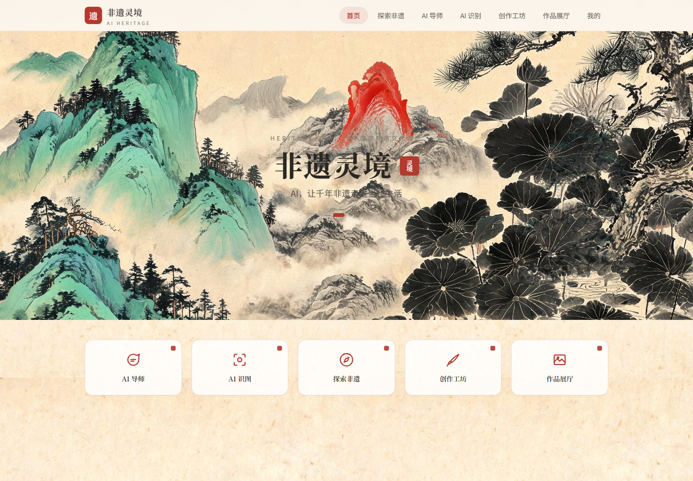
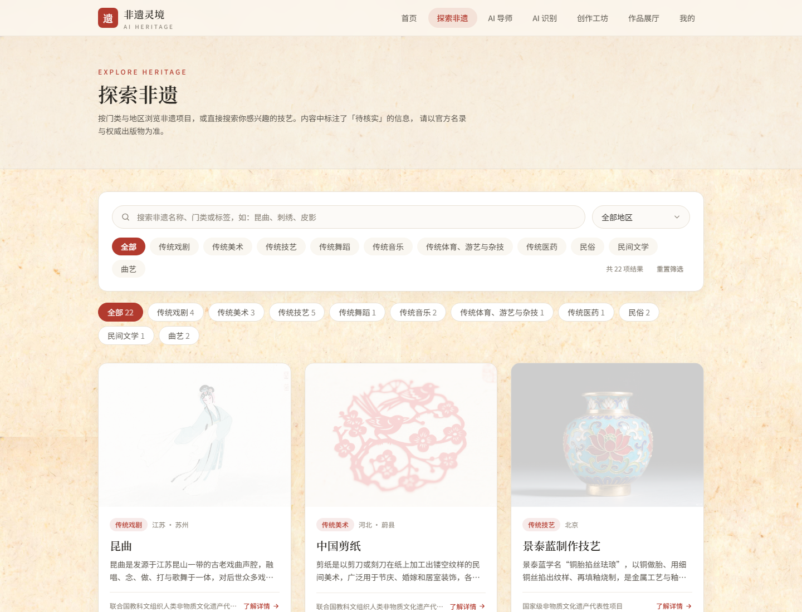
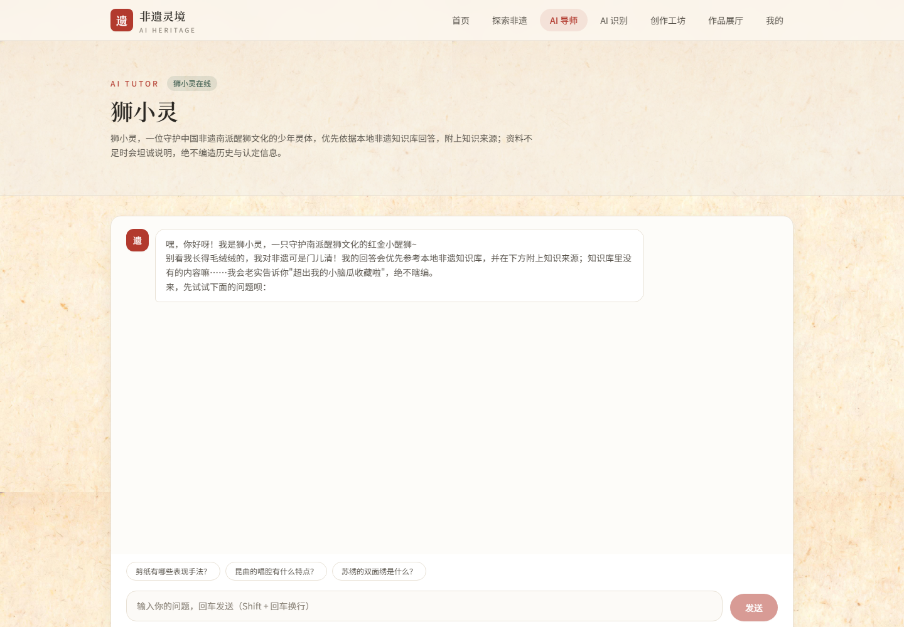
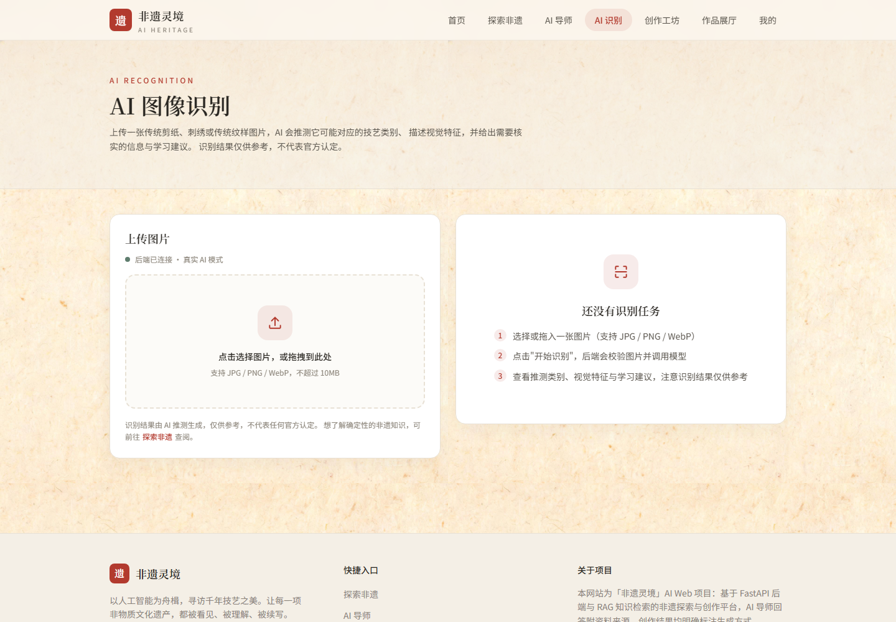
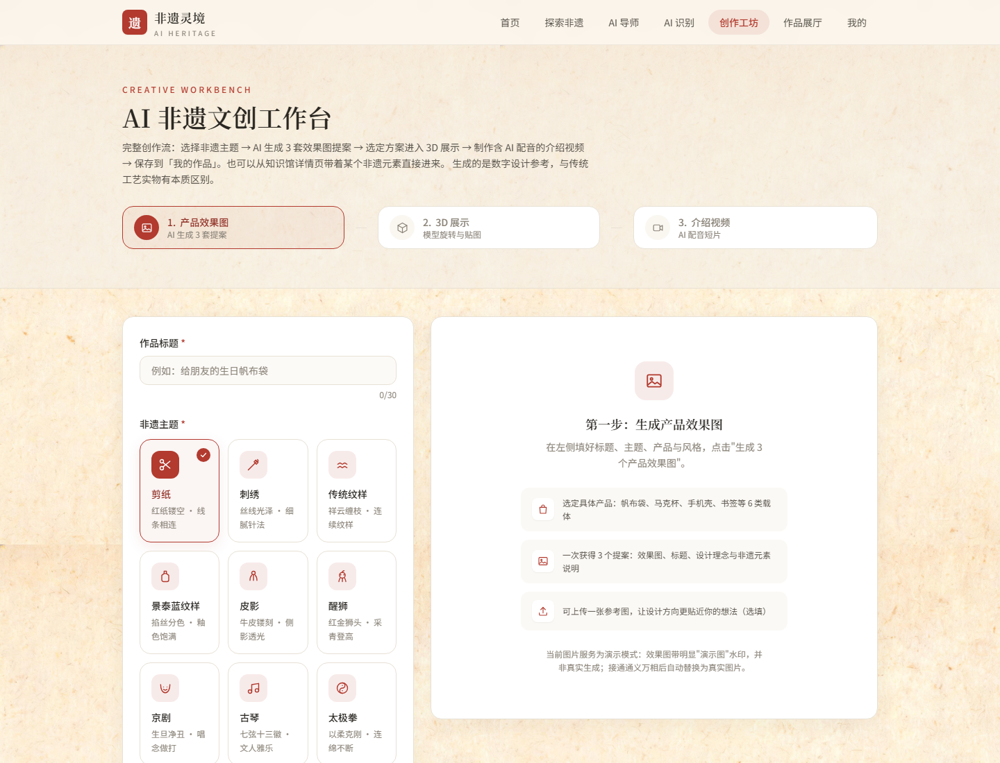
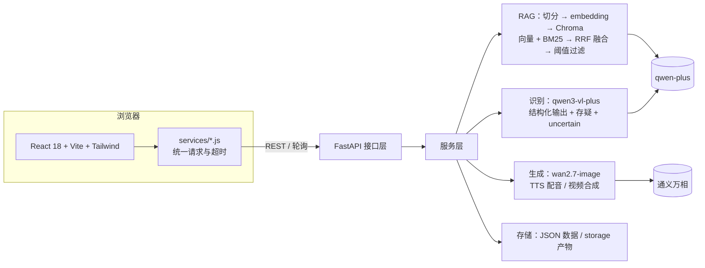

# 非遗灵境 · AI 非遗探索与创作平台

面向公众的非物质文化遗产数字化平台。把 22 项国家级非遗整理为可检索、可问答、可识别的结构化知识库，并提供 AI 文创设计、3D 展示、配音与短视频生成能力，最终沉淀为一座数字展厅。

> 参赛团队：**铃兰队**　成员：**黄泽玲、陈雅兰**



## 目录

- [项目简介](#项目简介)
- [功能特性](#功能特性)
- [界面预览](#界面预览)
- [技术架构](#技术架构)
- [目录结构](#目录结构)
- [快速开始](#快速开始)
- [环境变量](#环境变量)
- [依赖清单](#依赖清单)
- [AI 能力与评测](#ai-能力与评测)
- [部署说明](#部署说明)
- [团队信息](#团队信息)
- [安全说明](#安全说明)

## 项目简介

非遗的传播长期存在三重断层：**看不懂**（术语与流派门槛高）、**用不上**（传统元素难转化为当代产品）、**传不开**（缺少低门槛的参与方式）。

本项目把「认识—理解—创作—展示」串成一条链路：用户在探索页认识一项技艺，在 AI 导师处追问细节，用图像识别核对实物或设计稿，再进入创作工坊生成产品效果图、3D 展示与介绍视频，最后在作品展厅与个人空间查看、复用与再次创作。

平台有两个硬约束：

1. **可信**：答案必须来自知识库，证据不足时明确说明，不编造；
2. **可辨**：AI 生成内容、演示图与传统工艺实物分层标注，不混淆。

## 功能特性

| 模块 | 入口 | 能力 |
| --- | --- | --- |
| 探索非遗 | `/heritage` | 22 项非遗档案，按门类、地区、关键词筛选，详情含历史、技艺、代表作与资料来源 |
| AI 导师 | `/chat` | 「狮小灵」数字导师，基于 RAG 检索作答，答案附来源与弱证据提示 |
| AI 识别 | `/recognize` | 上传图片识别可能的非遗门类，输出候选、判断依据与无法确认的信息 |
| 创作工坊 | `/studio` | 单一非遗创作 + 2–3 项非遗跨界融合；效果图 → 3D 展示 → 配音视频 |
| 作品展厅 | `/gallery` | 22 项非遗照片墙 + 平台真实作品陈列，支持筛选与再次创作 |
| 我的空间 | `/me` | 作品、收藏、学习记录汇总与快捷入口 |

## 界面预览

| 探索非遗 | AI 导师 |
| --- | --- |
|  |  |

| AI 识别 | 创作工坊 |
| --- | --- |
|  |  |

## 技术架构



**技术栈**

- 前端：React 18、Vite 5、TailwindCSS 3、React Router 6、Three.js + @react-three/fiber + drei
- 后端：FastAPI、Pydantic、httpx、Pillow、imageio-ffmpeg
- 检索：fastembed（BAAI/bge-small-zh-v1.5，本地 ONNX）+ Chroma + BM25 + RRF
- 模型：qwen-plus（文本）、qwen3-vl-plus（视觉）、wan2.7-image（文生图）、qwen3-tts-flash（语音）
- 数据：items.json（22 项非遗）、Chroma 向量库、storage/generated 与 storage 音视频产物

## 目录结构

```text
feiyi/
├─ src/                     # 前端源码
│  ├─ pages/                # 六大页面：Home/Heritage/Chat/ImageRecognition/CreativeStudio/Gallery/MySpace
│  ├─ components/           # 领域组件（studio / recognize / heritage / decor / cursor / intro）
│  ├─ services/             # 接口封装（chat / recognize / studio / fusion / works ...）
│  ├─ utils/                # 图片、格式化等工具
│  └─ index.css             # 设计令牌与公共组件类
├─ public/images/           # 非遗素材、山水装饰、人物插画
├─ backend/
│  ├─ main.py               # FastAPI 入口
│  ├─ config.py             # 环境变量集中配置
│  ├─ api/                  # 路由：chat / studio / fusion / recognize / persona / works ...
│  ├─ services/             # rag / embedding / keyword / image / video / tts / asr / fusion / stores
│  ├─ knowledge/items.json  # 22 项非遗结构化档案
│  ├─ eval/                 # 检索与识别评测集、评测报告
│  ├─ data/                 # 运行时：Chroma 向量库（不入库）
│  └─ storage/              # 运行时：生成图 / 音频 / 视频（不入库）
├─ docs/shots/              # 界面截图
├─ scripts/                 # 构建与辅助脚本
└─ .env.example             # 见 backend/.env.example
```

## 快速开始

### 环境要求

- Node.js 18+
- Python 3.11+
- （可选）真实 AI 模式需自备通义千问 / 通义万相 API Key

### 1. 启动前端

```bash
npm install
npm run dev          # http://localhost:5173
```

### 2. 启动后端

```bash
cd backend
python -m venv .venv
# Windows
.venv\Scripts\activate
# macOS / Linux
source .venv/bin/activate

pip install -r requirements.txt
uvicorn main:app --host 127.0.0.1 --port 8000
```

首次启动会自动下载中文 embedding 模型（约 90MB）并构建知识库索引；离线环境可设置 `EMBEDDING_PROVIDER=naive` 使用伪向量兜底。

### 3. 配置环境变量

```bash
cd backend
copy .env.example .env      # Windows
cp .env.example .env        # macOS / Linux
```

默认 `AI_MODE=mock`、`IMAGE_MODE=demo`，**不填任何密钥即可完整体验**。要调用真实模型，将 `AI_MODE` / `IMAGE_MODE` 改为 `real` 并填写 `AI_API_KEY`。

### 4. 登录

访问 http://localhost:5173 ，使用任意账号 + 不少于 6 位密码即可进入演示环境（仅本地演示，不上传第三方）。

## 环境变量

完整清单见 [`backend/.env.example`](backend/.env.example)，常用项：

| 变量 | 默认值 | 说明 |
| --- | --- | --- |
| `AI_MODE` | `mock` | `mock` 演示回答 / `real` 真实模型 |
| `AI_API_KEY` | 空 | 真实模型密钥，仅后端读取 |
| `AI_BASE_URL` | 百炼兼容地址 | OpenAI 兼容接口 |
| `AI_MODEL` | `qwen-plus` | 文本与融合方案模型 |
| `AI_VISION_MODEL` | `qwen3-vl-plus` | 图像识别模型 |
| `IMAGE_MODE` | `demo` | `demo` 演示图 / `real` 通义万相 |
| `IMAGE_API_KEY` | 空 | 不填则复用 `AI_API_KEY` |
| `IMAGE_MODEL` | `wan2.7-image` | 文生图模型 |
| `IMAGE_SYNC_TIMEOUT_S` | `240` | 单张生图超时 |
| `VIDEO_MODE` | `demo` | 视频合成模式 |
| `TTS_MODEL` | `qwen3-tts-flash` | 语音合成模型 |
| `EMBEDDING_PROVIDER` | `fastembed` | `fastembed` / `naive` |
| `RETRIEVE_TOP_K` / `RETRIEVE_CANDIDATES` | `3` / `10` | 召回条数与每路候选数 |
| `HYBRID_SEARCH` / `RRF_K` / `BM25_MIN_SCORE` | `1` / `60` / `2.0` | 混合检索参数 |
| `SIMILARITY_THRESHOLD` | `0.85` | 相似度阈值（真实模型下自动收紧） |
| `MAX_UPLOAD_MB` | `10` | 上传大小上限 |

> `.env` 已被 `.gitignore` 忽略，任何情况下都不要把真实密钥写入代码或前端。

## 依赖清单

- 前端：`package.json`（React 18、Vite、TailwindCSS、Three.js / R-three-fiber、React Router）
- 后端：`backend/requirements.txt`（FastAPI、uvicorn、httpx、Pillow、chromadb、fastembed、imageio-ffmpeg 等）
- 模型权重：`fastembed` 首次运行自动下载到 `backend/.models_cache`，不入库

## AI 能力与评测

**检索（RAG）**：中文句子边界切分（260 字 / 40 字重叠）→ 本地 embedding → Chroma → 向量 + BM25 双路召回 → RRF 融合 → 阈值与最低分过滤 → qwen-plus 生成并附来源。

| 检索方式 | 题量 | 命中率 | Recall@3 | 拒答准确率 | 纯关键词命中率 |
| --- | --- | --- | --- | --- | --- |
| 纯向量 | 21 | 100% | 100% | 100% | 0% |
| 向量 + BM25 + RRF | 21 | 100% | 100% | 100% | 5.56% |

**识别**：7 个用例（清晰工艺图、现代文创、印花商品、模糊图、风景、抽象图形、数字文创），结果为 4 PASS / 3 REVIEW / 0 FAIL——给候选而不是硬下结论。

评测脚本与报告位于 `backend/eval/`，可重复执行并留存带时间戳的报告。

## 部署说明

前端：

```bash
npm run build        # 产物在 dist/
```

将 `dist/` 部署到任意静态服务器；开发期由 Vite 代理 `/api` 到 `127.0.0.1:8000`，生产环境需在网关把 `/api` 反向代理到后端。

后端：

```bash
uvicorn main:app --host 0.0.0.0 --port 8000
```

需要持久化 `backend/data`（向量库、任务）与 `backend/storage`（生成产物）；`backend/.env` 通过环境变量或密钥管理服务注入，不入库。

## 团队信息

| 项目 | 信息 |
| --- | --- |
| 团队名称 | 铃兰队 |
| 团队成员 | 黄泽玲、陈雅兰 |
| 承担工作 | 需求与产品设计、AI 能力选型与评测、前后端开发与联调、视觉设计与文档撰写 |
| 完成时间 | 2026 年 11 月 |

## 开发约定

- 目录分层：页面（`src/pages`）只负责编排，领域组件（`src/components/*`）与接口封装（`src/services`）各自独立
- 后端按业务域拆分 `api/` 与 `services/`，服务层不直接依赖 FastAPI，便于单测与替换模型供应商
- 注释说明“为什么”而不是“做了什么”；参数、阈值与超时均有中文注释与出处
- 提交信息采用 `feat / fix / docs / refactor / chore` 前缀，一次提交只做一件事
- 新增非遗项目只需修改 `backend/knowledge/items.json`，无需改动检索逻辑

## 安全说明

- 所有 API 密钥仅从后端环境变量读取（`backend/.env`），代码中无任何硬编码密钥
- `.env`、`.env.*`、`*.pem`、`*.key` 均已写入 `.gitignore`；仓库仅保留不含真实值的 `.env.example`
- 前端不使用 `VITE_` 前缀变量，浏览器不接触任何密钥；所有模型调用经 FastAPI 转发
- 上传文件限制 10MB 且仅允许 jpeg / png / webp
- 生成产物与运行时数据位于 `backend/storage`、`backend/data`，不进入版本库

## 声明

项目中的非遗档案与插画用于学习与演示，版权归原作者与相关机构所有；AI 生成内容均为数字文创方案，不代表真实文物或传统工艺品。
